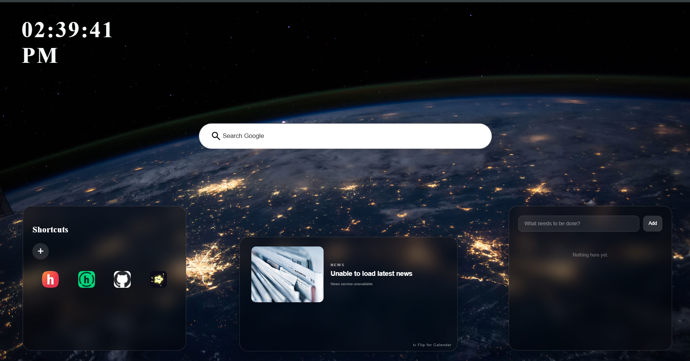

# New Tab Page

Hello Reader

I am Rudra Goel..

I have built this New Tab Page as part of my Hack Club journey! This New Tab Page is a custom browser tab page that contains many useful features such as a clock Google Search, Website Shortcuts, a To‑Do List, a Calendar and Technology News.

The idea behind this New Tab Page is to make the default new tab page a little more useful and interesting!

## The features are as follows:

### `Digital Clock`

The Digital Clock shows the time in 12‑hour format.

It updates every second so you always have the time displayed!

### `Google Search`

Google Search lets you search Google directly from the New Tab Page.

It is simple just type in what you are looking for!

### `Website Shortcuts`

Website Shortcuts give quick access to your favourite websites!

You can add your shortcuts remove existing ones and the website favicons are fetched automatically.

The shortcuts are saved using browser storage so they stay there even after refreshing the page!

### `To-Do List`

The To‑Do List is a tool to keep track of your tasks.

You can add tasks mark them as completed delete them and keep track of how many're remaining.

Your tasks are also saved locally!

### `Calendar`

The Calendar displays the date and month in a calendar layout.

It highlights the day so you can quickly check the date without opening another tab.

### `Technology News`

Technology News gives you the technology news right from your New Tab Page!

It uses Bing News RSS to fetch articles and RSS2JSON to process the feed.

It displays the article title, source, publication time and thumbnail when available.

You can also click on an article to read the story!

The news automatically refreshes every 10 minutes.

There is a little flip animation that lets you switch between the Calendar and Technology News sections!

---

## Running it locally

If you want to run the project yourself you will need a things first:

- A modern web browser (Chrome, Firefox, Edge, etc.)

- A code editor (VS Code recommended)

- Git (optional for cloning the repository)

- An internet connection for Google Search, favicons and technology news

No Node.js, npm or additional package installations are required!

### Installation

First clone the repository:

```bash

git clone https://github.com/rudraagoel/HCB_NewTabPage_Stardance.git

```

Then go into the project directory:

```bash

cd HCB_NewTabPage_Stardance

```

And that is much it!

### Running the project

You can simply open `index.html` in your browser.

Alternatively if you are using VS Code install the Live Server extension open the project folder, right‑click `index.html` and select **Open, with Live Server**.

Your New Tab Page should now be running!


If you want to use this New Tab Page as your browser new tab page you will need a browser extension that allows you to set a custom new tab URL.

Deployed Version: https://hcbstardance-newtablayout.vercel.app/
## Technologies used

A things I used while building this:

- **HTML** – For the structure of the page.

- **CSS** – For styling, layouts and animations.

- **JavaScript** – For all the functionality and interactions.

- **Local Storage** – To save shortcuts and To‑Do tasks

- **Bing News RSS** – To fetch technology news.

- **RSS2JSON API** – To process the news feed.

- **Google Favicons** – To fetch website icons.

---

## Troubleshooting

A things that might go wrong:

- **Page not loading:** Make sure you are opening `index.html` in a modern browser.

- **Shortcuts disappearing:** Check if your browser is clearing storage.

- **Tasks not saving:** Make sure local storage is enabled in your browser.

- **News not loading:** Check your internet connection. The RSS2JSON service or Bing News feed might be temporarily unavailable.

- **Favicons not appearing:** Check your internet connection as these are fetched externally.

- **Google Search not working:** Make sure you have an internet connection.

If you are still having issues you can check the repository. Open an issue!

---

**P.S.:** This project originally started as part of Hack Club Stardance. I initially considered moving it to Live YSWS, but eventually decided to submit it to Hack Club Pixl instead.

This was a fun little project to build and a nice way to experiment with frontend development, JavaScript, browser local storage, APIs and UI design!

Proj. Preview:



It is also one of the projects I am building during my Hack Club journey.


Thank you for checking out my project!
